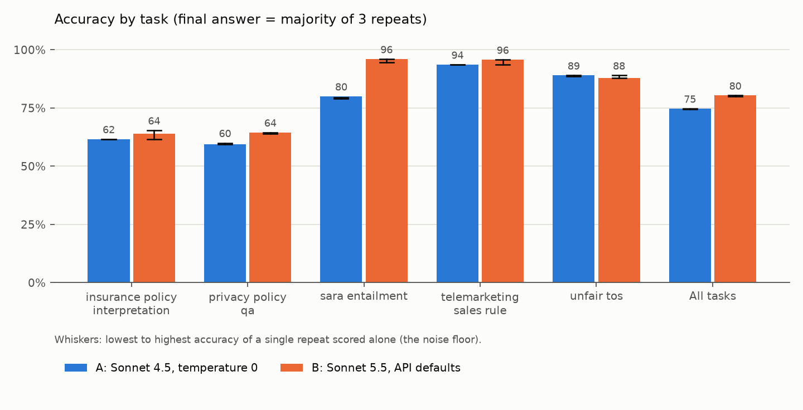
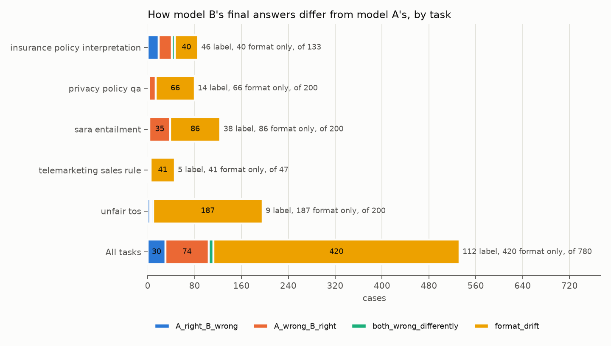

# Model-change evidence: Sonnet 4.5, temperature 0 vs Sonnet 5.5, API defaults

Run `20261012T222853Z`, started 2026-10-12 22:28 UTC. 780 public LegalBench cases in 5 compliance tasks, each sent 3 times to each arm. Every call is recorded in a SHA-256 hash chain; `model-diff verify 20261012T222853Z` re-checks it offline. Chain head at report time: `b718cc499855d36a7be589b6514741256ddc484d14192e6922478b4b3cc03ba3`.

Models, as reported by the models endpoint when the run started (2026-10-12): `claude-sonnet-4-5-20250929` (Claude Sonnet 4.5, lifecycle `active`), `claude-sonnet-5-5` (Claude Sonnet 5.5, lifecycle `active`); judge `claude-haiku-5-5` (Claude Haiku 5.5, lifecycle `active`).

## Headline: arm A vs arm B

Arm A is Sonnet 4.5, temperature 0; arm B is Sonnet 5.5, API defaults, the configuration a team gets by switching the model ID and dropping the parameters the new model rejects.

| Measure | A | B | Change |
|---|---|---|---|
| Accuracy, all tasks (95% Wilson CI) | 74.7% (71.6%–77.7%) | 80.4% (77.5%–83.0%) | +5.6 pts (exact McNemar p = 1.89e-05; 30 cases only A got right, 74 only B) |
| Cases whose final answer (label) changed | | | 112 of 780 (14.4%) |
| Cases with the same label but a change in strict JSON compliance | | | 420 of 780 |
| Noise floor: chance two runs of the same arm disagree | 0.9% | 2.5% | |
| Single runs of A and B disagree | | | 14.5% of run pairs |
| Parse failures (per call) | 0.04% | 0.00% | -0.0 pts |
| Not exactly the requested JSON (per call) | 69.10% | 12.69% | -56.4 pts |
| Refusals (per call) | 0.00% | 0.00% | +0.0 pts |
| Mean latency, sequential probes | 1,992 ms | 2,373 ms | 50 and 50 calls |
| Mean output tokens per call (thinking included) | 67 | 182 | B thinking: 74 |

Flag rate is the share of cases whose final answer is the task's affirmative label. For `unfair_tos` the flag is "any potentially unfair category", reweighted from the label-stratified sample to the full test split's mix.

| Task | Flag means | A | B | Change |
|---|---|---|---|---|
| `insurance_policy_interpretation` | Yes | 29.3% | 34.6% | +5.3 pts |
| `privacy_policy_qa` | Relevant | 13.0% | 19.0% | +6.0 pts |
| `sara_entailment` | Entailment | 37.0% | 50.0% | +13.0 pts |
| `telemarketing_sales_rule` | Yes | 57.4% | 55.3% | -2.1 pts |
| `unfair_tos` | any unfair category (reweighted) | 36.9% | 32.7% | -4.2 pts |

## Per-task results

| Task | Cases | Accuracy A | Accuracy B | Change | Noise floor A / B | Parse fail A / B | Refusal A / B | Latency A / B |
|---|---|---|---|---|---|---|---|---|
| `insurance_policy_interpretation` | 133 | 61.7% (53.2%–69.5%) | 63.9% (55.5%–71.6%) | +2.3 pts | 1.5% / 6.0% | 0.00% / 0.00% | 0.00% / 0.00% | 2,419 ms / 2,230 ms |
| `privacy_policy_qa` | 200 | 59.5% (52.6%–66.1%) | 64.5% (57.7%–70.8%) | +5.0 pts | 0.3% / 1.0% | 0.00% / 0.00% | 0.00% / 0.00% | 1,609 ms / 1,700 ms |
| `sara_entailment` | 200 | 80.0% (73.9%–85.0%) | 96.0% (92.3%–98.0%) | +16.0 pts | 1.7% / 3.7% | 0.17% / 0.00% | 0.00% / 0.00% | 2,016 ms / 3,839 ms |
| `telemarketing_sales_rule` | 47 | 93.6% (82.8%–97.8%) | 95.7% (85.8%–98.8%) | +2.1 pts | 0.0% / 1.4% | 0.00% / 0.00% | 0.00% / 0.00% | 2,334 ms / 2,538 ms |
| `unfair_tos` | 200 | 89.0% (83.9%–92.6%) | 88.0% (82.8%–91.8%) | -1.0 pts | 0.3% / 0.7% | 0.00% / 0.00% | 0.00% / 0.00% | 1,582 ms / 1,560 ms |
| **All tasks** | 780 | 74.7% (71.6%–77.7%) | 80.4% (77.5%–83.0%) | +5.6 pts | 0.9% / 2.5% | 0.04% / 0.00% | 0.00% / 0.00% | 1,992 ms / 2,373 ms |

`unfair_tos` was sampled with equal shares per label. Reweighted to the full test split's label mix, accuracy is 71.8% for A and 75.5% for B.



## What changed between A and B

Each case is classified by comparing the two arms' final answers: `same`; `A_right_B_wrong` and `A_wrong_B_right` (the answer changed and exactly one matches the reference label); `both_wrong_differently`; `format_drift` (one side's answer could not be parsed, or the label held but strict JSON compliance changed); `refusal_change`.

| Category | `insurance_policy_interpretation` | `privacy_policy_qa` | `sara_entailment` | `telemarketing_sales_rule` | `unfair_tos` | All |
|---|---|---|---|---|---|---|
| `same` | 47 | 120 | 76 | 1 | 4 | 248 |
| `A_right_B_wrong` | 19 | 2 | 3 | 2 | 4 | 30 |
| `A_wrong_B_right` | 22 | 12 | 35 | 3 | 2 | 74 |
| `both_wrong_differently` | 5 | 0 | 0 | 0 | 3 | 8 |
| `format_drift` | 40 | 66 | 86 | 41 | 187 | 420 |
| `refusal_change` | 0 | 0 | 0 | 0 | 0 | 0 |

Of the 420 `format_drift` cases, 420 kept the same label and changed only strict JSON compliance: in 401 the majority of A's repeats broke the format and B's did not, and in 19 the reverse. In 0, one side's answer could not be parsed at all. How each arm's responses missed the requested format (per call): A: JSON in a Markdown code fence 1591, text before or after the JSON 25, no parseable label 1; B: text before or after the JSON 297. A lenient parser reads these labels; a strict one would reject them.

The judge (claude-haiku-5-5) described each changed case. Natures of change: format change 260, other 167, more lenient 63, stricter 29, misread instruction 8, judge unparseable 5. These are model judgements, not ground truth; `diffs_sample_for_review.csv` holds a 30-case stratified sample with blank `human_verdict` and `notes` columns for checking them.



## Sequential attribution along the path A → C → D → B

Each step changes one factor. For every case whose final answer differs between the first and last arm, the steps whose two arms give different final answers are the factors that moved it. **This is sequential attribution along one path.** Factors can interact, so a different order of changes could split the shares differently. The order here is the only one the API allows, because Sonnet 5.5 cannot run at temperature 0.

| Step | Factor | Final answers differ | Single runs differ | Noise floors of the two arms |
|---|---|---|---|---|
| A → C | temperature | 1.3% | 2.3% | 0.9% / 2.9% |
| C → D | model | 16.3% | 16.7% | 2.9% / 3.1% |
| D → B | thinking | 8.8% | 9.0% | 3.1% / 2.5% |

Of the 112 cases whose final answer differs between A and B:

| Factor | Moved the answer alone | Involved (alone or with others) |
|---|---|---|
| model | 81 (72.3%) | 84 (75.0%) |
| temperature | 1 (0.9%) | 2 (1.8%) |
| thinking | 27 (24.1%) | 30 (26.8%) |

Combinations of steps that moved each changed case: model: 81, model+thinking: 2, temperature: 1, temperature+model+thinking: 1, thinking: 27. A step can also move an answer and a later step move it back; such cases are not in this count.

## All arms

| Arm | Configuration | Accuracy (95% CI) | Noise floor | Unanimous cases | Parse fail | Refusal | Mean output tokens | Mean thinking tokens |
|---|---|---|---|---|---|---|---|---|
| A | Sonnet 4.5, temperature 0 | 74.7% (71.6%–77.7%) | 0.9% | 98.7% | 0.04% | 0.00% | 67 | n/a |
| B | Sonnet 5.5, API defaults | 80.4% (77.5%–83.0%) | 2.5% | 96.3% | 0.00% | 0.00% | 182 | 74 |
| C | Sonnet 4.5, temperature 1.0 | 74.2% (71.0%–77.2%) | 2.9% | 95.6% | 0.04% | 0.00% | 69 | n/a |
| D | Sonnet 5.5, thinking off | 77.7% (74.6%–80.5%) | 3.1% | 95.5% | 1.03% | 0.00% | 114 | 0 |

## `unfair_tos` per-category precision and recall (exploratory)

Per-category numbers rest on about two dozen cases per label and are exploratory; the headline uses the pooled "any unfair" flag above.

| Label | Support | Precision A | Recall A | Precision B | Recall B |
|---|---|---|---|---|---|
| Arbitration | 15 | 78.9% | 100.0% | 78.9% | 100.0% |
| Choice of law | 24 | 100.0% | 91.7% | 100.0% | 91.7% |
| Content removal | 23 | 100.0% | 78.3% | 94.7% | 78.3% |
| Contract by using | 23 | 100.0% | 82.6% | 100.0% | 78.3% |
| Jurisdiction | 23 | 95.8% | 100.0% | 95.8% | 100.0% |
| Limitation of liability | 23 | 88.5% | 100.0% | 88.5% | 100.0% |
| Other | 23 | 88.9% | 69.6% | 70.8% | 73.9% |
| Unilateral change | 23 | 83.3% | 87.0% | 79.2% | 82.6% |
| Unilateral termination | 23 | 73.3% | 95.7% | 87.5% | 91.3% |

## Method

1. 780 cases from 5 LegalBench test splits (commit `daec8237410a`), drawn with seed 42; `unfair_tos` is label-stratified, the others random or whole.
2. Every case went 3 times to each arm through the Message Batches API with byte-identical prompts; arms differ only in the parameters stored with every record.
3. Responses are parsed as JSON; an arm's final answer is the majority of its repeats; refusals come from the API's stop reason, a rule set, and the judge.
4. Final answers of arms A and B are compared case by case, the judge describes each change, and the change is attributed to temperature, model, and thinking along the control arms.
5. Each call is hash-chained to the frozen config, cases, prompts, and models snapshot; latency comes from separate sequential calls, since batch results carry none.

## Caveats

- **Noise floor.** Arm B cannot run at temperature 0 (the API rejects it), so it carries sampling noise that arm A does not: two runs of B disagree on 2.5% of cases, against 0.9% for A. Changes at or below these rates are not evidence of a model change. Final answers are majorities of three repeats, which reduces but does not remove that noise.
- **Sampling.** Sample sizes per task: `insurance_policy_interpretation` 133, `privacy_policy_qa` 200, `sara_entailment` 200, `telemarketing_sales_rule` 47, `unfair_tos` 200. The small tasks have wide intervals. `unfair_tos` is label-stratified, so its unweighted accuracy and flag rate describe the sample; reweighted figures are given. Pooled accuracy is over the sample as drawn.
- **Attribution** is sequential along one path, and interactions between factors mean another order could split the shares differently.
- **Judge.** Refusal decisions for ambiguous responses and every change description come from claude-haiku-5-5, which cannot run deterministically. Its answers are recorded once and reused, and a human review sample is provided.
- **Reference labels** are LegalBench's. Some are contestable (the insurance task's labels come from crowd agreement, including an explicit "ambiguous" class), so accuracy measures agreement with them.
- **One point in time.** Model behavior behind a pinned ID can still change; the models-list snapshot records what the API reported when the run started.
- **Latency** comes from 50 sequential calls per arm plus any direct fallback calls, not from the batch, and depends on load at the time.
- **Output limit.** Calls that stopped at their arm's `max_tokens` limit: arm A 1 (`sara_entailment` 1; 1 without a parseable label); arm C 1 (`sara_entailment` 1; 1 without a parseable label); arm D 22 (`sara_entailment` 22; 22 without a parseable label). Those without a label count as parse failures, which understates the arm on that task and touches the attribution steps that involve it. Truncated answers are reasoning written into the visible response before the JSON.
- **Reweighting.** The reweighted `unfair_tos` figures give 90.6% of the weight to the 23 sampled `Other` cases, so they are much less certain than the unweighted ones.

## Cost

| Item | Spend |
|---|---|
| arm A latency probe | \$0.10 |
| arm A preflight | \$0.00 |
| arm A subject | \$2.22 |
| arm B latency probe | \$0.16 |
| arm B preflight | \$0.00 |
| arm B subject | \$3.07 |
| arm C latency probe | \$0.10 |
| arm C preflight | \$0.00 |
| arm C subject | \$2.24 |
| arm D latency probe | \$0.10 |
| arm D preflight | \$0.00 |
| arm D subject | \$2.28 |
| judge | \$0.07 |
| **Total** | **\$10.33** |

Cost cap \$35.00. After the pilot, the run projected \$11.80 from measured usage and kept arms A, B, C, D. Prices: Anthropic list prices on 2026-10-12, with the Batch API at half price.

## Reproduce and verify

```sh
uv run model-diff verify 20261012T222853Z   # offline: re-walks the hash chain and frozen artifacts
uv run model-diff report 20261012T222853Z   # offline: rebuilds this report from the run directory
```

## Data and licenses

Cases are from LegalBench (Guha et al., 2023). Task licenses: `insurance_policy_interpretation` CC BY 4.0; `privacy_policy_qa` MIT; `sara_entailment` MIT; `telemarketing_sales_rule` CC BY 4.0; `unfair_tos` CC BY 4.0. Source datasets should be cited as their LegalBench task cards ask.
